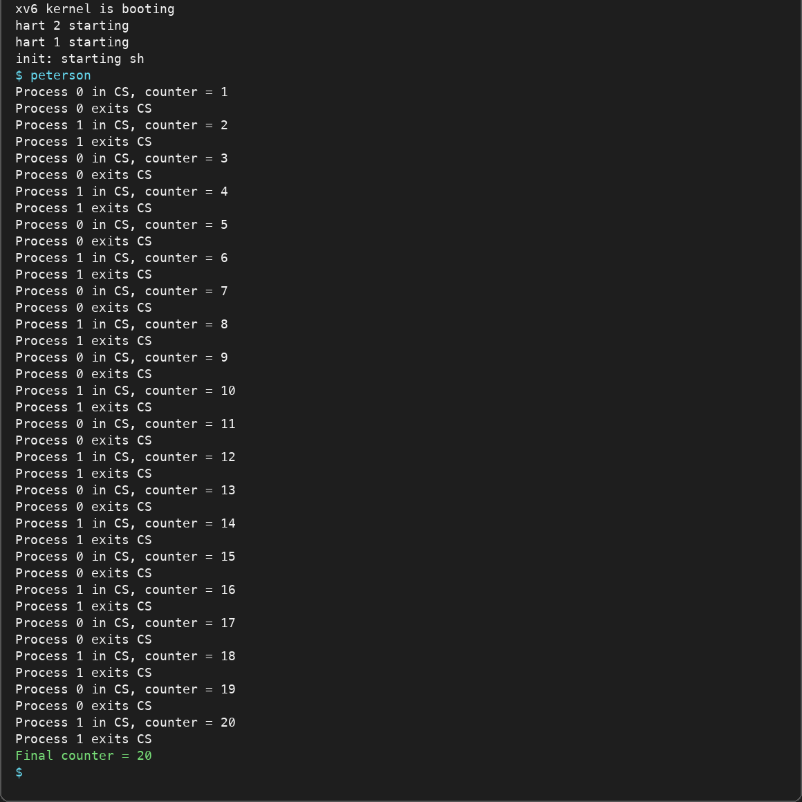
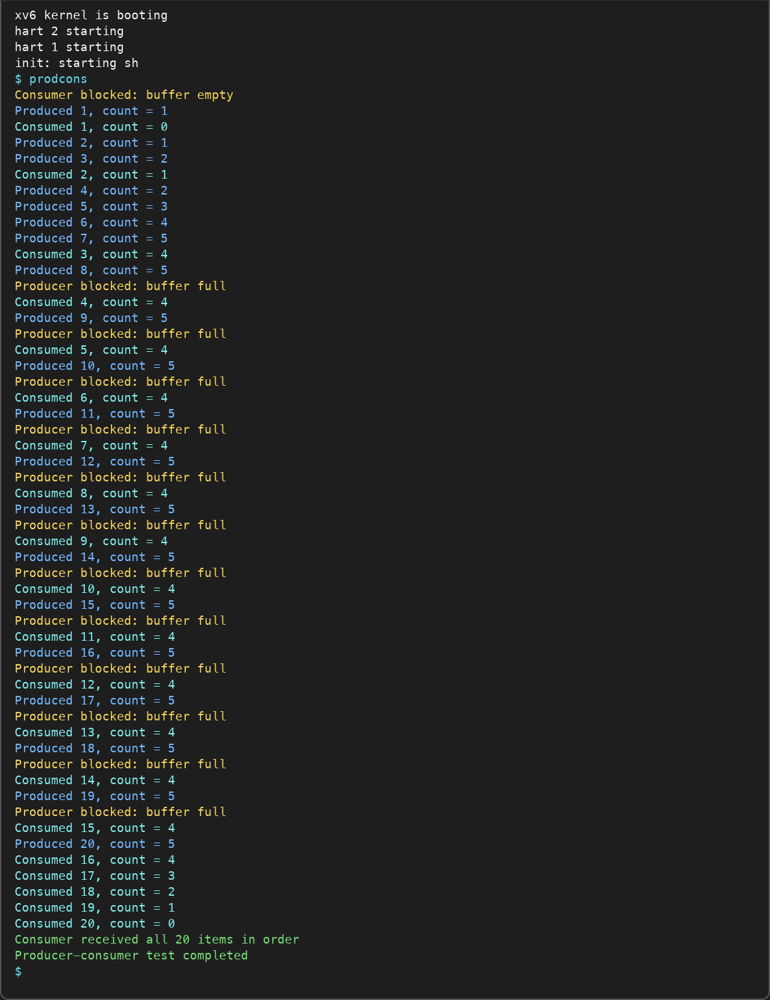
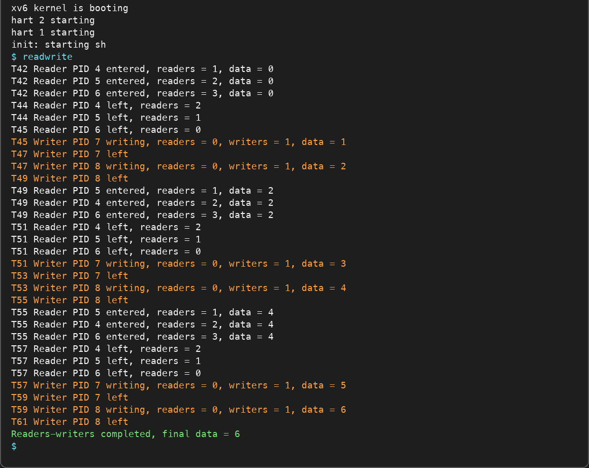

# Varun Kumar
# Assignments 5

## Build and start xv6 in QEMU
```sh
make clean
make qemu
```

## Question 1

`shm_get()` maps one kernel-allocated page at the same virtual address in a process. `fork()` maps the same physical page in the child. Peterson's `flag` and `turn` values are stored in this page. Memory barriers keep their accesses ordered on RISC-V.

Build and run:

```sh
make qemu
peterson
```

The final counter must be 20.



## Question 2

The circular buffer is stored in the page returned by `shm_get()`. The child mappings point to the same physical page. Kernel semaphores use `sleep()` and `wakeup()`. Semaphore 0 counts empty slots, semaphore 1 counts full slots, and semaphore 2 is the mutex.

Build and run:

```sh
make qemu
prodcons
```

An optional buffer size from 1 to 5 can be passed, such as `prodcons 3`.



## Question 3

The shared integer and reader count are stored in a shared page. `RMUTEX` protects the reader count. The first reader locks `RESOURCE` and the last reader unlocks it, so readers can overlap while writers remain exclusive. `TURN` is a turnstile: a waiting writer holds it and prevents new readers from passing, which prevents writer starvation.

Build and run:

```sh
make qemu
readwrite
```

The final shared value must be 6.

